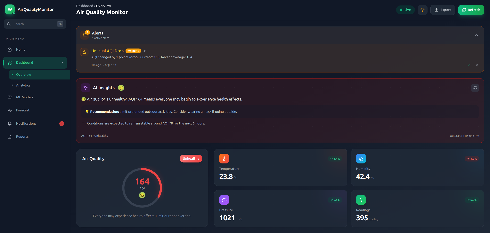
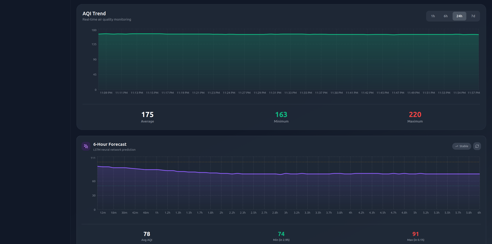
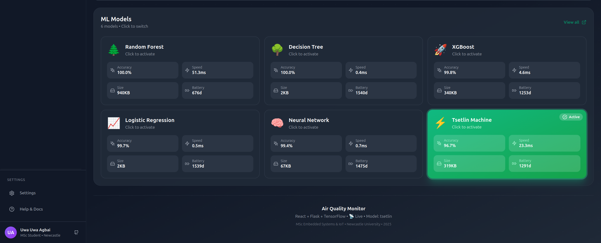

# Air Quality Monitor

An IoT air-quality monitor built around a BME680 sensor on an ESP8266. Each node sends readings over **Wi-Fi to an MQTT broker** (or over USB serial as a fallback). A Flask backend stores them, runs ML models and a 6-hour forecast, and raises alerts on a live React dashboard.



<details>
<summary>More screenshots</summary>




</details>

## Features

| | |
|---|---|
| **Wi-Fi/MQTT telemetry** | Nodes publish JSON readings to `aq/<node>/reading` every 30 s |
| **Survives dropouts** | Non-blocking reconnect with back-off (1 s up to 30 s); readings are buffered on the node while offline and sent later with their age, so the backend stores them at the time they were measured |
| **Online/offline status** | Retained status topic with an MQTT last-will message, so the backend knows when a node disappears |
| **Remote commands** | `READ`, `STATUS`, `INFO`, `PING` over MQTT (`aq/<node>/cmd`) or serial |
| **On-device air-quality index** | Humidity-compensated index (0–500) from the BME680 gas resistance, computed on the ESP8266 |
| **6 ML models compared** | Decision tree, random forest, XGBoost, neural network, logistic regression and a Tsetlin machine, compared on inference time and estimated energy |
| **6-hour forecast** | LSTM time-series forecast of the air-quality index |
| **Alerts** | Threshold, anomaly (sudden spikes), trend (sustained worsening) and forecast-based alerts |
| **Dashboard** | React + Recharts, live readings, history, forecast and alerts, dark/light mode |

## Architecture

```
  BME680 ──I2C──▶ ESP8266 (WeMos D1)
                   • reads sensor every 30 s
                   • computes air-quality index
                   • buffers readings while offline
                        │
          ┌─────────────┴──────────────┐
     Wi-Fi / MQTT                 USB serial (fallback)
          │                            │
          ▼                            │
   MQTT broker (Mosquitto)             │
     aq/<node>/reading                 │
     aq/<node>/status (last will)      │
     aq/<node>/cmd  ◀── commands       │
          │                            │
          └─────────────┬──────────────┘
                        ▼
              Flask backend (Python)
               • ML classification + LSTM forecast
               • alert manager
               • SQLite storage
               • REST API
                        │
                        ▼
               React dashboard (Vite)
```

The ML models run on the backend, not on the microcontroller. The node only computes the rule-based air-quality index.

## Hardware

- **Board:** WeMos D1 (ESP8266)
- **Sensor:** Bosch BME680 (temperature, humidity, pressure, gas/VOC)

| BME680 | ESP8266 | Notes |
|---|---|---|
| VCC | 3.3V | Do not use 5V |
| GND | GND | |
| SCL | GPIO5 | I2C clock |
| SDA | GPIO4 | I2C data |
| SDO | GND | I2C address 0x76 (0x77 if tied to 3.3V; the firmware tries both) |
| CS | 3.3V | Selects I2C mode |

## MQTT topics

| Topic | Direction | Payload |
|---|---|---|
| `aq/<node>/reading` | node → backend | Reading JSON (below) |
| `aq/<node>/status` | node → backend | `{"status":"online"}` / `{"status":"offline"}` (retained; offline is the last will) |
| `aq/<node>/cmd` | you → node | `READ`, `STATUS`, `INFO` or `PING` |
| `aq/<node>/reply` | node → you | Command replies, e.g. Wi-Fi signal strength and buffer state for `STATUS` |

Example reading:

```json
{"type":"reading","node_id":"bme680_node_01","location":"Room","temperature":21.48,
 "humidity":45.20,"pressure":1012.30,"gas_resistance":95000,"aqi":55,
 "reading_num":42,"age_ms":0}
```

`age_ms` is how long ago the reading was taken. It is 0 for live readings and larger for readings sent after a dropout.

## Getting started

### 1. MQTT broker

```bash
sudo apt install mosquitto mosquitto-clients
```

Mosquitto 2 only accepts local connections by default. To let the board connect, create `/etc/mosquitto/conf.d/aq.conf`:

```
listener 1883 0.0.0.0
allow_anonymous true
```

Then `sudo systemctl restart mosquitto`. This open setup is for a home or lab network only.

### 2. Firmware

```bash
cd firmware
cp include/secrets.example.h include/secrets.h   # add Wi-Fi name, password and your computer's IP
pio run --target upload
pio device monitor                                # serial output
```

`secrets.h` is ignored by git. The ESP8266 only joins 2.4 GHz WPA2-Personal networks (not university/enterprise Wi-Fi); a phone hotspot works.

Watch readings arrive:

```bash
mosquitto_sub -h localhost -t 'aq/#' -v
mosquitto_pub -h localhost -t aq/bme680_node_01/cmd -m STATUS
```

The original serial-only sketch is kept in `arduino/air_quality_node.ino`.

### 3. Backend

```bash
cd backend
python -m venv venv && source venv/bin/activate
pip install -r requirements.txt
python ml/train_all.py                      # train the 6 classifiers

python app.py --source mqtt                 # readings over Wi-Fi (MQTT_HOST/MQTT_PORT env vars, default localhost:1883)
python app.py                               # readings over USB serial
python app.py --demo                        # simulated readings, no hardware
```

### 4. Dashboard

```bash
cd frontend
npm install
npm run dev     # http://localhost:5173
```

## ML models

Six classifiers predict one of five air-quality categories (good, moderate, unhealthy for sensitive groups, unhealthy, very unhealthy) from temperature, humidity and gas resistance. They are trained on the [UCI Air Quality dataset](https://archive.ics.uci.edu/dataset/360/air+quality).

| Model | Inference time | Est. energy per inference |
|---|---|---|
| Decision tree | 0.4 ms | 0.004 mJ |
| Logistic regression | 1.1 ms | 0.005 mJ |
| Neural network | 1.3 ms | 0.14 mJ |
| XGBoost | 3.6 ms | 0.69 mJ |
| Tsetlin machine | 23.9 ms | 0.58 mJ |
| Random forest | 62.6 ms | 3.84 mJ |

Times are measured on the backend computer. Energy is an estimate (assumed power × inference time), not a measurement. All six reach near-perfect accuracy because the category label is a threshold on gas resistance, which is also an input, so accuracy does not separate them; speed and energy do. A label from an independent reference instrument would be the next step.

The LSTM forecaster uses the last 24 hours of readings to predict the next 6 hours (`python -m ml.forecasting.train_forecast`, needs collected data).

## Project structure

```
air-quality-monitor/
├── firmware/                  # PlatformIO project (Wi-Fi/MQTT + serial)
│   ├── platformio.ini
│   ├── include/secrets.example.h
│   └── src/main.cpp
├── arduino/
│   └── air_quality_node.ino   # original serial-only sketch
├── backend/
│   ├── app.py                 # Flask API, data sources, startup
│   ├── mqtt_source.py         # MQTT subscriber
│   ├── config.py
│   ├── database.py            # SQLite
│   ├── simulator.py           # demo data
│   ├── alerts/alert_manager.py
│   └── ml/                    # classifiers, training, LSTM forecasting
├── frontend/                  # React + Vite dashboard
└── screenshots/
```

## API

| Endpoint | Method | Description |
|---|---|---|
| `/api/health` | GET | Health check |
| `/api/latest` | GET | Latest reading |
| `/api/readings?hours=24` | GET | Historical readings |
| `/api/stats?hours=24` | GET | Aggregated statistics |
| `/api/chart?hours=24` | GET | Chart data |
| `/api/models` | GET | Available models |
| `/api/models/compare` | GET | Model comparison |
| `/api/models/set` | POST | Switch active model |
| `/api/forecast` | GET | 6-hour forecast |
| `/api/forecast/summary` | GET | Hourly forecast summary |
| `/api/alerts/active` | GET | Active alerts |
| `/api/alerts/<id>/acknowledge` | POST | Acknowledge an alert |
| `/api/alerts/<id>/dismiss` | POST | Dismiss an alert |

## Next steps

- [ ] Several nodes on one broker (the topics already include the node ID)
- [ ] Deep sleep between readings for battery power
- [ ] TLS and username/password on the broker
- [ ] Docker setup

## Author

**Uwa Uwa Agbai**, MSc Embedded Systems and Internet of Things, Newcastle University
[LinkedIn](https://linkedin.com/in/uwa-agbai) · [GitHub](https://github.com/uwaagbai1)

## License

MIT, see [LICENSE](LICENSE).
